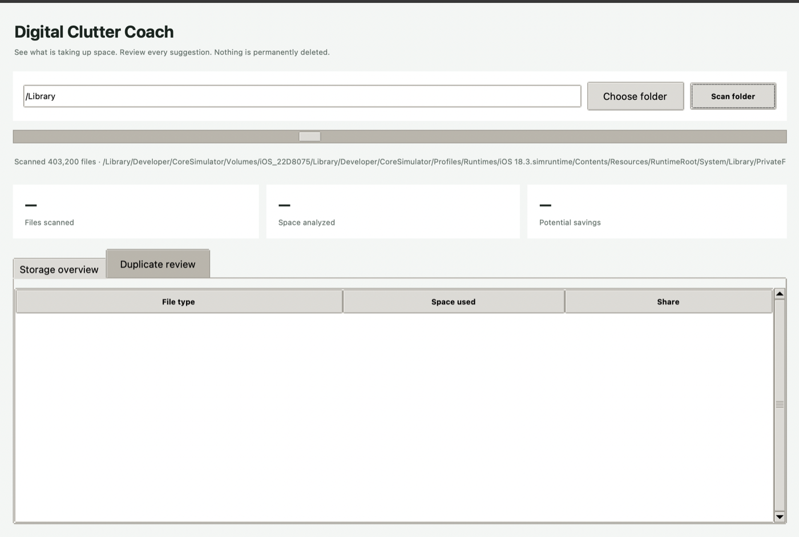

# Digital Clutter Coach

Digital Clutter Coach is a privacy-first desktop utility for understanding folder usage, finding exact duplicate files, and safely reclaiming disk space. It runs entirely on your computer—no file names, contents, or statistics are uploaded.

Built with Python and Tkinter for Windows and macOS.



## Features

- Analyze any folder selected by the user
- See disk usage grouped into clear file categories
- Find true duplicates using size filtering and SHA-256 verification
- Protect the oldest copy in every duplicate group by default
- Select exactly which duplicate copies should be cleaned up
- Review a final summary before approving any file operation
- Move approved files to Trash or the Recycle Bin instead of permanently deleting them
- Cancel long scans without affecting files
- Skip symbolic links and continue safely past inaccessible locations

## Safety model

- Scanning is read-only and limited to the folder you choose.
- Symbolic links are skipped, so a scan cannot wander outside the selected folder through a link.
- Duplicate candidates are confirmed with a SHA-256 content hash, not only matching names or sizes.
- The oldest copy in every duplicate group is protected by default.
- Nothing moves until you select candidates and approve the confirmation dialog.
- Approved files go to the operating system Trash/Recycle Bin. They are not permanently erased by the app.

## Requirements

- Python 3.10 or newer
- Tkinter, which is included with standard Python installers on Windows and macOS

## Run from source

Clone the repository, open a terminal in its directory, and follow the instructions for your operating system.

### Windows

```powershell
py -m venv .venv
.venv\Scripts\activate
py -m pip install -r requirements.txt
py run.py
```

### macOS

```bash
python3 -m venv .venv
source .venv/bin/activate
python3 -m pip install -r requirements.txt
python3 run.py
```

On macOS, allow folder access if the system asks. Protected folders may require enabling access under **System Settings → Privacy & Security → Files and Folders**.

## How it works

1. Choose a folder and start a scan.
2. The app records file sizes and categories without modifying anything.
3. Files with matching sizes are compared using SHA-256 content hashes.
4. The oldest copy in each exact-match group is marked **Keep**.
5. Extra copies are shown as cleanup candidates.
6. Only selected candidates are moved after you approve the confirmation dialog.

Large folders can take time because duplicate candidates must be read to verify their contents. The scan runs in a background thread so the interface remains responsive.

## Build a standalone app

Install the development requirements first:

```bash
python -m pip install -r requirements-dev.txt
```

Build on each target operating system (PyInstaller does not cross-compile):

```bash
python build.py
```

The result appears under `dist/`. The build script applies the native `.ico` icon on Windows and `.icns` icon on macOS. Run it on Windows for a Windows `.exe`, and on macOS for a macOS `.app`.

## Tests

```bash
python -m pytest
```

The tests cover size formatting, categories, content-verified duplicates, default copy protection, and symbolic-link handling.

## Privacy and safety

The app does not use a server, analytics, or cloud storage. Scans are read-only. Cleanup requires explicit confirmation and uses the operating system's recoverable Trash or Recycle Bin mechanism through `Send2Trash`.

As with any file-management utility, review candidates carefully and keep backups of important data. Emptying Trash or the Recycle Bin is outside this app and may permanently remove files.

## Project structure

```text
clutter_coach/
├── app.py       # Tkinter interface and cleanup approval flow
├── core.py      # Folder scanning, categorization, hashing, and duplicate grouping
└── __init__.py
tests/
└── test_core.py
run.py           # Application entry point
```

## Contributing

Bug reports and focused pull requests are welcome. Please run `python -m pytest` before submitting a change.

## License

Licensed under the MIT License. See [LICENSE](LICENSE).
